

<a href="https://ruicodex.com">
  <picture>
    <source media="(prefers-color-scheme: dark)" srcset="media/banner.svg">
    
  </picture>
</a>

### We design, build and run software end to end: from AI agents to mobile games.

    

**[Website](https://ruicodex.com)** · **[Case studies](https://ruicodex.com/CaseStudies)** · **[Google Play](https://play.google.com/store/apps/dev?id=6565660224420086428)** · **[App Store](https://apps.apple.com/us/developer/selman-altinay/id1895496718)** · **[Watch the showreel](https://github.com/RuiCodex-dev/.github/blob/main/profile/media/rui-codex-showreel.mp4)**

 

<a href="https://github.com/RuiCodex-dev/.github/blob/main/profile/media/rui-codex-showreel.mp4">
  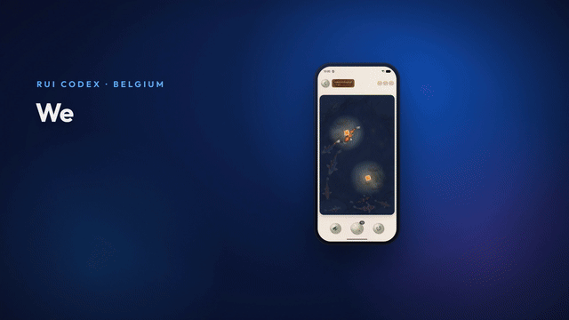
</a>

<b>&#9654; Watch the 40-second showreel</b> (with sound): real screen recordings of our own apps and games, and ruicodex.com.

 

## About Rui Codex

**Rui Codex** is a Belgian software engineering studio (Tielt-Winge, Flanders), founded in 2026 by Selman Altinay.
We build AI automation, custom software, Odoo/ERP systems and integrations for businesses in Belgium and across the EU,
and we design, publish and maintain our own mobile apps and games: **39 titles on Google Play** at the latest count on our website.

## What we build

<table>
  <tr>
    <td width="33%" valign="top">
      <h3>&#129302; AI automation and agents</h3>
      LLM-powered agents and workflow automation that do real work inside the tools a team already uses.
    </td>
    <td width="33%" valign="top">
      <h3>&#128187; Custom software</h3>
      Web platforms, APIs, dashboards and internal tools on .NET, Python and modern web stacks.
    </td>
    <td width="33%" valign="top">
      <h3>&#128279; Integrations</h3>
      ERP, e-commerce, accounting and third-party APIs connected so data moves on its own.
    </td>
  </tr>
  <tr>
    <td width="33%" valign="top">
      <h3>&#129513; Odoo and ERP</h3>
      Implementation, custom modules, migration and integrations, tailored to how the business runs.
    </td>
    <td width="33%" valign="top">
      <h3>&#128241; Mobile apps and games</h3>
      Flutter and Unity, shipped to Google Play and the App Store, and kept running after launch.
    </td>
    <td width="33%" valign="top">
      <h3>&#127760; Five languages</h3>
      We work in English, Dutch, French, German and Turkish, from Belgium for clients across the EU.
    </td>
  </tr>
</table>

## Our own apps and games

Products we build and run ourselves. Every tile opens the real store listing.

  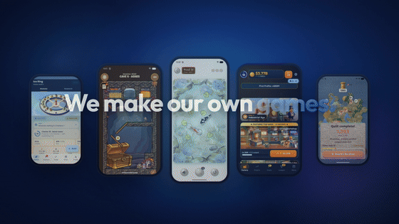
   
  Real gameplay: Koi Drift, Pull &amp; Plunder and Factory Legacy.

 

<table>
  <tr>
    <td width="33%" valign="top">&nbsp;<b>Koi Drift</b> &nbsp;A calm koi pond puzzle &nbsp;<a href="https://play.google.com/store/apps/details?id=com.ruicodex.koidrift">Google Play</a></td>
    <td width="33%" valign="top">&nbsp;<b>Pull &amp; Plunder</b> &nbsp;Pin-pull physics puzzles &nbsp;<a href="https://play.google.com/store/apps/details?id=com.ruicodex.pullplunder">Google Play</a></td>
    <td width="33%" valign="top">&nbsp;<b>Factory Legacy: Idle Empire</b> &nbsp;Build your factory empire &nbsp;<a href="https://play.google.com/store/apps/details?id=com.ruicodex.IdleFactoryTycoon">Google Play</a> · <a href="https://apps.apple.com/us/app/factory-legacy-idle-empire/id6777828643">App Store</a></td>
  </tr>
  <tr>
    <td valign="top">&nbsp;<b>Star Harbor</b> &nbsp;Build a space station that really works &nbsp;<a href="https://play.google.com/store/apps/details?id=com.ruicodex.starharbor">Google Play</a></td>
    <td valign="top">&nbsp;<b>Quiltvale</b> &nbsp;Stitch a cozy felt world &nbsp;<a href="https://play.google.com/store/apps/details?id=com.ruicodex.quiltvale">Google Play</a></td>
    <td valign="top">&nbsp;<b>Lumen Loop</b> &nbsp;Bend, split and mix light &nbsp;<a href="https://play.google.com/store/apps/details?id=com.ruicodex.lumenloop">Google Play</a></td>
  </tr>
  <tr>
    <td valign="top">&nbsp;<b>Ant Empire</b> &nbsp;Dig chambers, raise a queen &nbsp;<a href="https://play.google.com/store/apps/details?id=com.ruicodex.ant_empire">Google Play</a></td>
    <td valign="top">&nbsp;<b>Idle Defense: Cosmic TD</b> &nbsp;Idle tower defense across a galaxy &nbsp;<a href="https://play.google.com/store/apps/details?id=com.ruicodex.idledefense">Google Play</a></td>
    <td valign="top">&nbsp;<b>Candy Chaos</b> &nbsp;Sort candies into matching boxes &nbsp;<a href="https://play.google.com/store/apps/details?id=com.ruicodex.candychaos">Google Play</a> · <a href="https://apps.apple.com/us/app/candy-chaos-sweet-sort/id6779695174">App Store</a></td>
  </tr>
  <tr>
    <td valign="top">&nbsp;<b>Grandma's Kitchen</b> &nbsp;Cooking fun in a city of flavors &nbsp;<a href="https://play.google.com/store/apps/details?id=com.ruicodex.grandmaskitchen">Google Play</a></td>
    <td valign="top">&nbsp;<b>Gravity Block Flip</b> &nbsp;Flip gravity, the stack falls the other way &nbsp;<a href="https://play.google.com/store/apps/details?id=com.ruicodex.gravity_block_flip">Google Play</a></td>
    <td valign="top">&nbsp;<b>PixelCut Pro</b> &nbsp;AI background remover, 39 studio backgrounds &nbsp;<a href="https://play.google.com/store/apps/details?id=com.ruicodex.pixelcut_pro">Google Play</a> · <a href="https://apps.apple.com/us/app/pixelcut-pro-ai-bg-remover/id6777847573">App Store</a></td>
  </tr>
  <tr>
    <td valign="top">&nbsp;<b>EveryTranslate</b> &nbsp;Text, documents and voice, many languages at once &nbsp;<a href="https://play.google.com/store/apps/details?id=com.everytranslate.app">Google Play</a></td>
    <td valign="top">&nbsp;<b>Florea</b> &nbsp;Journal and planner, a quiet place for your day &nbsp;<a href="https://play.google.com/store/apps/details?id=com.ruicodex.florea">Google Play</a></td>
    <td valign="top">&nbsp;<b>StandBy Clock</b> &nbsp;Bedside clock and photo display &nbsp;<a href="https://play.google.com/store/apps/details?id=com.altinayselman.standbyclock">Google Play</a></td>
  </tr>
  <tr>
    <td valign="top">&nbsp;<b>LetsLearn</b> &nbsp;Vocabulary flashcards in 12 languages &nbsp;<a href="https://play.google.com/store/apps/details?id=com.ruicodex.letslearn">Google Play</a></td>
    <td valign="top">&nbsp;<b>DietSem</b> &nbsp;Snap your plate, plan your week &nbsp;<a href="https://play.google.com/store/apps/details?id=com.ruicodex.dietsem">Google Play</a></td>
    <td valign="top">&nbsp;<b>PosterBoost.ai</b> &nbsp;AI listings and posters for what you sell &nbsp;<a href="https://play.google.com/store/apps/details?id=com.ruicodex.posterboost.ai">Google Play</a></td>
  </tr>
</table>

More titles, including RadioSEM, Ringflip and Cipher Depths, are on our <a href="https://play.google.com/store/apps/dev?id=6565660224420086428">Google Play developer page</a> and at <a href="https://ruicodex.com">ruicodex.com</a>.

<b>Store art gallery</b> (the feature graphics from our live listings)

 

<table>
  <tr>
    <td>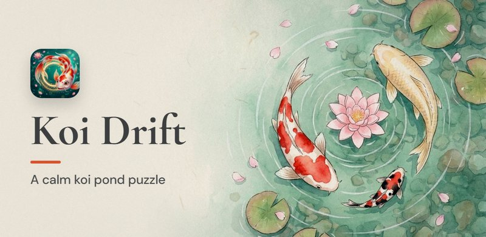</td>
    <td>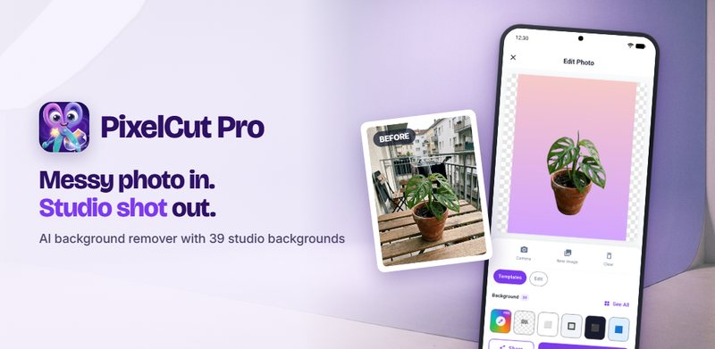</td>
  </tr>
  <tr>
    <td></td>
    <td></td>
  </tr>
  <tr>
    <td></td>
    <td>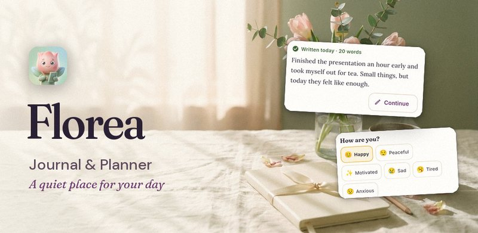</td>
  </tr>
  <tr>
    <td></td>
    <td>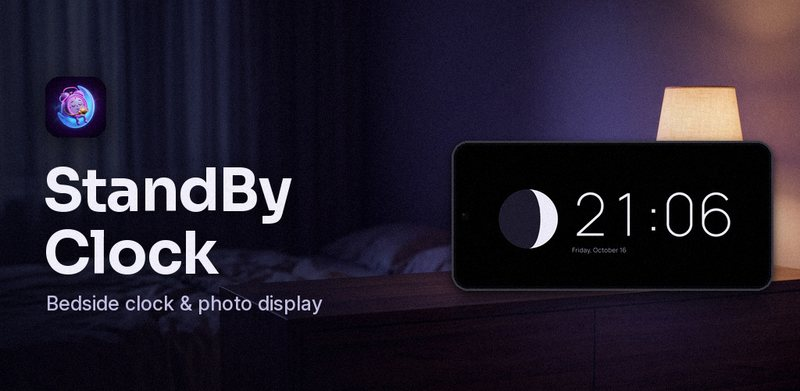</td>
  </tr>
  <tr>
    <td>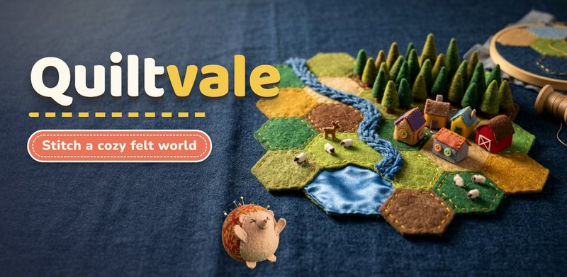</td>
    <td>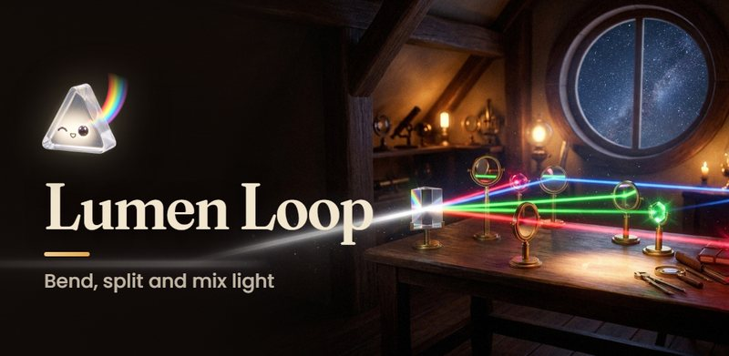</td>
  </tr>
  <tr>
    <td>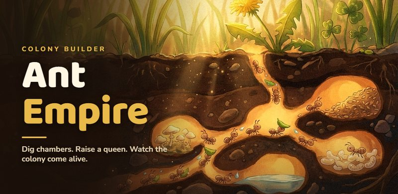</td>
    <td>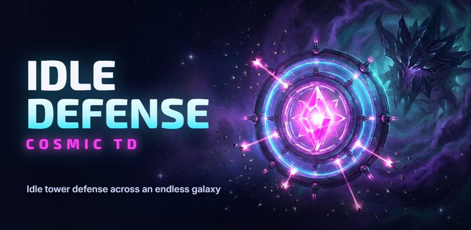</td>
  </tr>
  <tr>
    <td>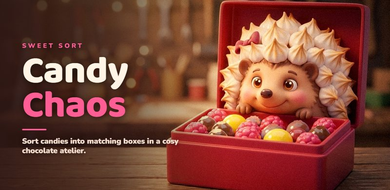</td>
    <td></td>
  </tr>
  <tr>
    <td>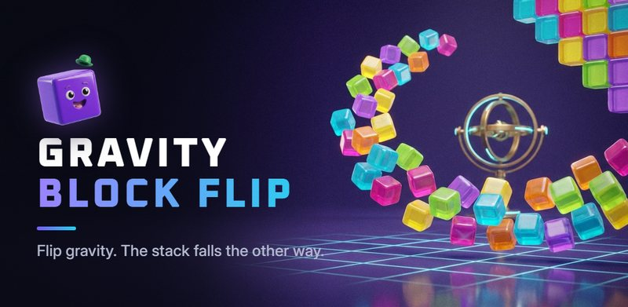</td>
    <td>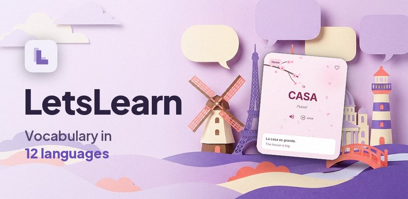</td>
  </tr>
  <tr>
    <td>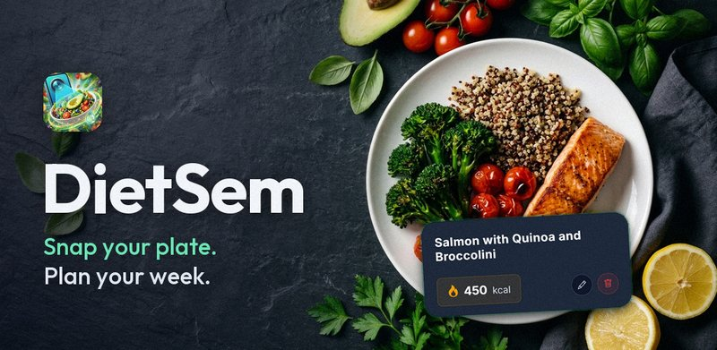</td>
    <td>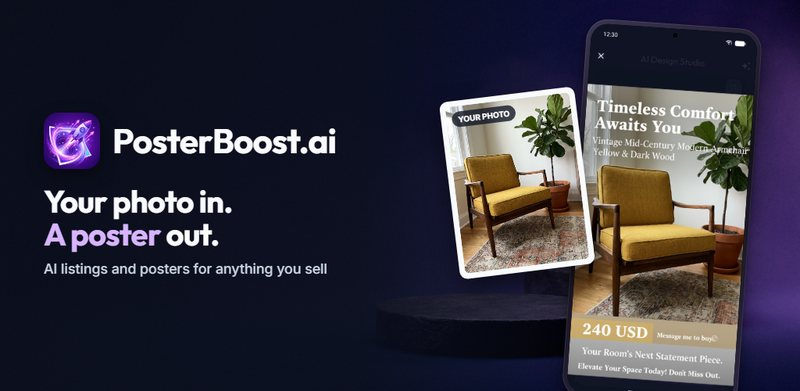</td>
  </tr>
</table>

## Selected work for clients

- **22 case studies** with the problem, the approach and the result: [ruicodex.com/CaseStudies](https://ruicodex.com/CaseStudies)
- Sectors include e-commerce and retail, manufacturing, agriculture and aquaculture, education, automotive and consumer electronics.

<table>
  <tr>
    <td width="68%"></td>
    <td width="32%" rowspan="2" align="center"></td>
  </tr>
  <tr>
    <td></td>
  </tr>
  <tr>
    <td colspan="2" align="center">ruicodex.com, captured on desktop (1440 px) and phone (390 px).</td>
  </tr>
</table>

## How we work

Five steps, as described on [ruicodex.com](https://ruicodex.com):

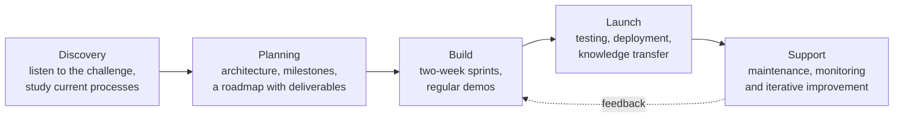

## Public builds (2026)

Hackathon and challenge projects we built in the open:

| Project | What it is |
|---|---|
| [**Hostwise**](https://github.com/RuiCodex-dev/hostwise) | An AI host that plans a dinner party for a group with different tastes, on Qloo's taste graph |
| [**Scopecast**](https://github.com/RuiCodex-dev/scopecast) | Monte-Carlo fixed-price quotes for freelance developers, with a confidence level you choose |
| [**Purser**](https://github.com/RuiCodex-dev/purser) | An AI treasurer for group events: PayPal Agent Toolkit and Gemini, with a mandate the agent can't break |
| [**Causeway**](https://github.com/RuiCodex-dev/open-agent-causeway) | An agent that explains why, with evidence |
| [**Invoice Airlock**](https://github.com/RuiCodex-dev/invoice-airlock) | Screens supplier emails with the Clocked API before they reach accounts payable |
| [**Hearthnote**](https://github.com/RuiCodex-dev/hearthnote) | A private notebook for families caring for someone at home, on NVIDIA Nemotron |
| [**WordRoom**](https://github.com/RuiCodex-dev/learn-ar-specs) | Learn Dutch de/het words on real-size kitchen objects, a Lens for Snap Specs |
| [**Emmy PTX**](https://github.com/RuiCodex-dev/emmy-ptx) | An Emmy kernel IR to NVIDIA PTX compiler |

## Stack

| Area | Tools |
|---|---|
| Backend | C# / .NET, ASP.NET Core, Python |
| Web | JavaScript / TypeScript |
| Mobile and games | Flutter / Dart, Unity |
| Data | SQL Server, PostgreSQL |
| ERP | Odoo |
| AI | OpenAI and Anthropic APIs, LLM agents and workflow automation |

## Contact

[ruicodex.com](https://ruicodex.com) · [info@ruicodex.com](mailto:info@ruicodex.com) · [LinkedIn](https://www.linkedin.com/company/ruicodex) · Belgium (KBO BE 1033.974.468)

---

All rights reserved, &copy; 2026 Rui Codex. Built by <a href="https://ruicodex.com">Rui Codex</a>. 
Media credits: every app and website screen in the showreel, GIFs and screenshots is a real capture of our live apps and of ruicodex.com; app icons and store art come from our own live Google Play listings; no new imagery was generated for this page. Narration: Kokoro TTS (voice af_heart), rendered locally. Music and sound effects were synthesised in code. Video built with HyperFrames.
